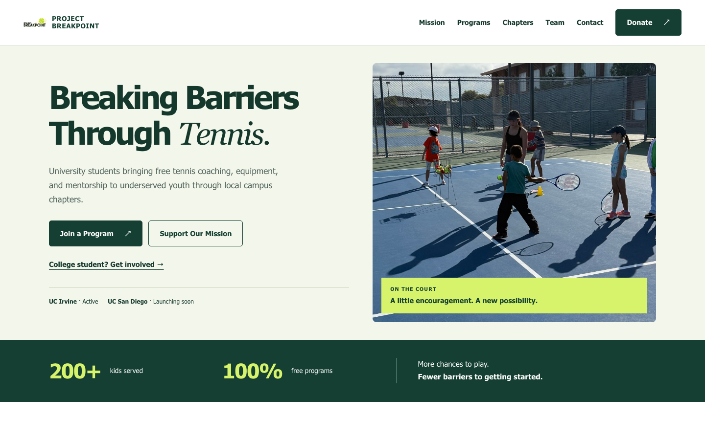

# Project Breakpoint

Project Breakpoint is a 501(c)(3) nonprofit that gives free tennis coaching, equipment, and mentorship to kids from low-income families. It runs through student-led university chapters: UC Irvine is active and UC San Diego is launching soon. This repo is the organization's website.

**Live site:** [theprojectbreakpoint.org](https://theprojectbreakpoint.org)



## What it does

- **Landing page** covering the mission, programs, chapters, and team, with expandable team bios.
- **Chapters page** where college students can ask to join an active chapter or help start a new one.
- **Events page** for clinic updates and volunteer sign-ups.
- **Contact form** with inquiry types (general, volunteer, donation, enrollment, partnership, chapter). Submissions are stored in MongoDB.
- **Email list sign-up** that stores subscribers in MongoDB and rejects duplicate emails.
- **Donations** through Venmo deep links with preset or custom amounts, plus a QR code.

## Tech stack and architecture

| Layer     | Tools                                                                         |
| --------- | ----------------------------------------------------------------------------- |
| Frontend  | React 19 (Create React App), React Router 7, Tailwind CSS 3, react-helmet     |
| Backend   | Node.js serverless functions on Vercel (`api/`)                               |
| Data      | MongoDB Atlas (`contacts` and `subscribers` collections)                      |
| Hosting   | Vercel, with Vercel Analytics and Speed Insights                              |
| Testing   | Jest + React DOM test utilities                                               |

```
Browser (React SPA)
  ├── static pages, client-side routing
  ├── POST /api/contact   ─┐
  └── POST /api/subscribe ─┴─> Vercel serverless functions ──> MongoDB Atlas
```

The React app is a static single-page app. Its only backend is two serverless functions in `api/`, which Vercel deploys automatically as endpoints. Each function validates and sanitizes its input, writes to MongoDB, and returns JSON.

### Notable decisions

- **Serverless functions instead of a server.** The site needs only two write endpoints, so Vercel functions avoid running and paying for a server.
- **Venmo instead of a payment processor.** Donations open a prefilled Venmo link, so the site never handles payment data.
- **Honest failure states.** If the database is unreachable, `/api/contact` returns `503` and asks the visitor to email the team instead of reporting a false success.
- **Accessibility.** The site has a skip link, visible focus styles, a mobile menu that closes on Escape, and dialogs that trap and restore keyboard focus.
- **Per-route metadata.** `RouteBehavior` updates page titles and Open Graph/Twitter tags on navigation and restores scroll position.
- **Content accuracy is tested.** The homepage test checks chapter statuses and confirms that no unverified claims, such as scholarships, appear on the page.

## Getting started

Requires Node.js 18+ and a MongoDB Atlas cluster (the free tier works).

```bash
npm install
cp .env.example .env.local   # then fill in MONGODB_URI
npm start                    # frontend only, at http://localhost:3000
```

`npm start` doesn't serve the `api/` functions. To test the forms locally, run the app with the [Vercel CLI](https://vercel.com/docs/cli):

```bash
npx vercel dev
```

Other scripts:

```bash
npm test          # run the test suite
npm run build     # production build in build/
```

### Environment variables

| Variable      | Required | Description                                                    |
| ------------- | -------- | -------------------------------------------------------------- |
| `MONGODB_URI` | Yes      | MongoDB Atlas connection string                                |
| `MONGODB_DB`  | No       | Database name for contact submissions (default `projectbreakpoint`) |

See [docs/CONTACT_FORM_SETUP.md](docs/CONTACT_FORM_SETUP.md) for MongoDB setup and the contact data schema.

## Project layout

```
api/                  Vercel serverless functions
  contact.js          POST /api/contact: store contact form submissions
  subscribe.js        POST /api/subscribe: store email subscribers
public/               Static assets, images, index.html, manifest
src/
  pages/              Route components (Home, About, Chapters, Events, Donate, Contact)
  components/         Shared UI (dialogs, cards, route behavior)
    layout/           Navbar and Footer
    shared/           Subscribe section
  data/               Team/founder content
  styles/             Tailwind entry and page CSS
  App.js              Routes, analytics
docs/                 Setup guides, redesign notes, screenshot
```

## Deploying

The repo is connected to Vercel, so every push to `main` deploys to production. Vercel builds the React app and deploys `api/` as serverless functions. Set `MONGODB_URI` (and `MONGODB_DB` if you use a different database) under **Project Settings → Environment Variables** in Vercel.

## More docs

- [docs/CONTACT_FORM_SETUP.md](docs/CONTACT_FORM_SETUP.md): MongoDB and email notification setup
- [docs/REDESIGN_HANDOFF.md](docs/REDESIGN_HANDOFF.md): landing page redesign notes and the team content checklist

## Contact

proj.breakpoint@gmail.com
